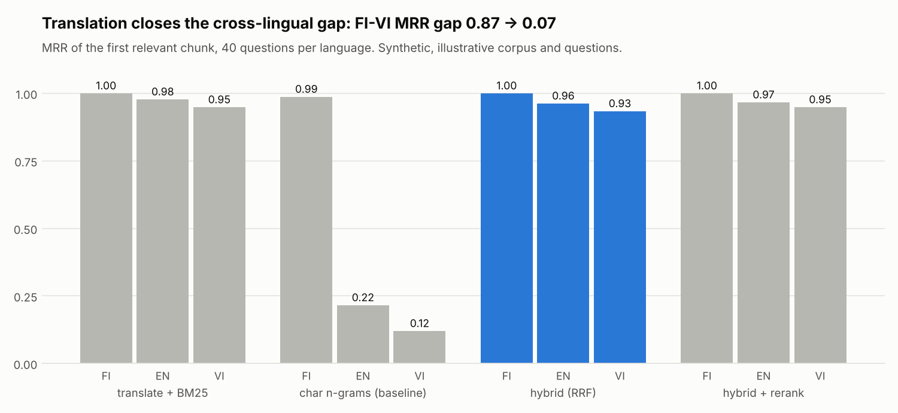
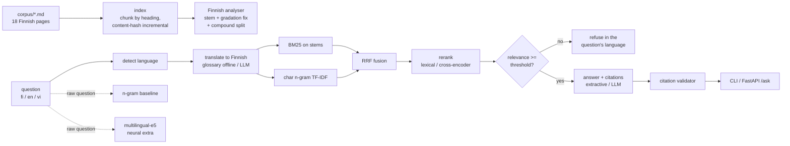
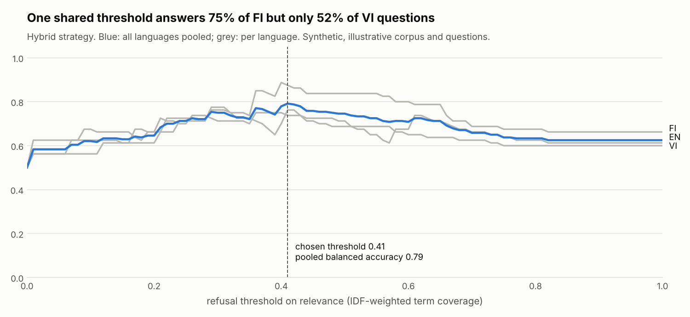

# Multilingual RAG over Finnish public-service pages (FI / EN / VI)


Can a newcomer ask in English or Vietnamese and get a correct, cited answer from Finnish-only
documents? This repo builds a small retrieval-augmented assistant over 18 Finnish
public-service style pages (library card, bus tickets, address change, waste sorting, health
centre, adult courses, tax card) and measures the **cross-lingual gap**: how much worse
retrieval and answering get when the same 40 questions are asked in English or Vietnamese
instead of Finnish, and how much each retrieval strategy closes that gap.

I am Vietnamese and I study Finnish for the YKI test, so this is a problem I have lived: the
official information exists, but in a language you are still learning.

**What this project shows**

- Finnish-aware search: Snowball stemming, a fix for consonant gradation, and compound
  splitting ("kirjastokortin" -> kirjasto + kortti), all tested.
- Four retrieval strategies compared per question language, with an offline glossary
  translator standing in for machine translation, and RRF fusion.
- Honest answering: citations that are checked, refusal below a relevance threshold chosen by a
  sweep, and answers that say what they are (a Finnish quote with a gloss, not a translation).
- An evaluation in three languages (40 + 8 questions each) with a CI gate on retrieval,
  refusal and the size of the cross-lingual gap.



> **Illustrative content, not official guidance.** I wrote all pages myself for this project.
> "Esimerkkilä" is a made-up town and its prices and opening hours are invented. Check the
> official site of the real service before acting on anything.

## Problem

Finnish public services publish their best information in Finnish. A newcomer who types
"How much is a 30-day season ticket?" into a Finnish search box gets nothing, because none of
those words appear in the Finnish page. Character n-grams (a common language-agnostic
baseline) find the right page for only 22% of English and 12% of Vietnamese questions. The goal
is to close that gap without pretending: cite the Finnish source, refuse when the documents do
not cover the question, and be clear about what an offline system can and cannot do.

## Architecture



Code walkthrough: **[docs/how-it-works.md](docs/how-it-works.md)**.
Why each choice was made: **[docs/decisions.md](docs/decisions.md)**.

## Quick start

```bash
python -m venv .venv && source .venv/bin/activate
make install
mlrag index                     # chunks the corpus into index/ (incremental)
mlrag ask "How much is a 30-day season ticket?"
mlrag ask "Vé tháng 30 ngày giá bao nhiêu?"
mlrag ask "Paljonko kalastuslupa maksaa?"      # not in the pages: refuses
make eval                       # all strategies x languages + the CI gate
make report                     # regenerates docs/results.md and the charts
make serve                      # API docs on http://localhost:8000/docs
```

```bash
curl -X POST localhost:8000/ask -H 'content-type: application/json' \
  -d '{"question": "How much is a 30-day season ticket?"}'
```

The English answer quotes the Finnish sentence, cites its chunk and glosses the key terms:

```text
The Finnish page "Matkakortti ja kausilippu" (Travel card and season ticket) says:
"30 päivän kausilippu maksaa aikuiselta 55 euroa." [matkakortti#1] ...
Key terms: kausilippu = season ticket; ...
This is a quote in Finnish, not a translation.
```

Real generation and translation: `MLRAG_PROVIDER=ollama` (local model through Ollama) or
`MLRAG_PROVIDER=openai` with `OPENAI_API_KEY` set. Neither is needed for anything above, and
neither was evaluated in this repo. Multilingual dense retrieval and a cross-encoder reranker
are behind `pip install ".[neural]"` and `MLRAG_NEURAL=1` (not run here: no model downloads in
the build environment).

## Results (synthetic)

All numbers come from `mlrag report` on the **synthetic, illustrative** corpus and eval set
(40 answerable + 8 unanswerable questions, each in Finnish, English and Vietnamese), with the
offline glossary translator and extractive answers. Full tables: [docs/results.md](docs/results.md).

| Strategy | MRR FI | MRR EN | MRR VI | Gap FI-VI | Share of baseline gap closed (EN / VI) |
| --- | --- | --- | --- | --- | --- |
| Char n-grams (baseline, no translation) | 0.99 | 0.22 | 0.12 | 0.867 | 0% / 0% |
| Translate + BM25 | 1.00 | 0.98 | 0.95 | 0.051 | 97% / 94% |
| **Hybrid (RRF), shipped** | **1.00** | **0.96** | **0.93** | **0.066** | **95% / 92%** |
| Hybrid + lexical rerank | 1.00 | 0.97 | 0.95 | 0.051 | 96% / 94% |
| Dense multilingual-e5 | not run here | | | | |

| Hybrid, threshold 0.41 | FI | EN | VI |
| --- | --- | --- | --- |
| Right page in top 3 (hit@3) | 1.00 | 0.97 | 0.97 |
| Answerable questions answered | 0.75 | 0.72 | 0.53 |
| Unanswerable questions refused | 1.00 | 0.75 | 1.00 |
| Citations valid (extractive) | 1.00 | 1.00 | 1.00 |

**The answer to the business question: retrieval, mostly yes; answering, only partly.** Query
translation closes about 92-95% of the retrieval gap. But one shared refusal threshold answers
75% of Finnish and only 53% of Vietnamese questions, because the glossary knows 70% of the
Vietnamese content words, and every unknown word lowers the relevance score. Lowering the
threshold would answer more and refuse fewer off-topic questions; the sweep shows that trade-off.



Caveats (also in results.md): one question is 0.025 of a rate; I wrote pages, questions and
glossary myself, which makes the numbers optimistic; the threshold is chosen on the same
questions it is scored on; extractive citations are valid by construction, the validator
earns its place with LLM answers.

## Design decisions (summary)

- **Translate the query, not the documents:** cheap, and the Finnish index stays the single
  source of truth. The glossary translator is an honest stand-in, with coverage reported.
- **Snowball + a final-vowel trim + compound splitting:** fixes the Finnish forms that broke
  matching in the eval (vaippa / vaipat, lääke / lääkkeet) without a heavy NLP model.
- **Hybrid with RRF:** BM25 on stems plus n-grams on the translated query; ranks only, no
  weight tuning. On this small set it is level with plain translate + BM25 (within 1-2
  questions).
- **IDF-weighted coverage as the relevance score:** a word the corpus has never seen
  ("kalastuslupa") pulls relevance down hard, which is what refusal needs.
- **Threshold from a sweep:** balanced accuracy, middle of the widest best range, and a test
  that fails if the shipped default goes stale.
- **Answers say what they are:** quotes plus a gloss offline; LLM answers must cite and are
  validated.

Full reasoning and costs: [docs/decisions.md](docs/decisions.md).

## Project layout

```
corpus/          18 illustrative Finnish pages in 6 files (one marker comment per page)
evals/           questions.yaml (40 + 8 questions x FI/EN/VI), thresholds.yaml (CI gate)
src/mlrag/
  text.py        normalisation, Finnish stemming + compounds, language detection
  corpus.py      page parsing, chunking by heading
  index.py       incremental index by content hash
  lexical.py     BM25 and character n-gram TF-IDF
  translate.py   glossary translator (offline) and LLM translator
  glossary.yaml  EN->FI and VI->FI domain glossary
  retrieval.py   strategies, RRF, relevance score, lexical reranker
  neural.py      multilingual-e5 and cross-encoder ([neural] extra)
  answer.py      extractive and LLM answers, citation validator, refusal
  llm.py         Ollama and OpenAI-compatible clients
  evals.py       metrics per language and strategy, threshold sweep, gap, gate
  report.py      docs/results.md and charts
  api.py         FastAPI /ask and /health
  cli.py         mlrag index | ask | eval | report | serve
tests/           50 tests (60 cases), 99% coverage
```

## Testing and quality

- **50 tests** cover the stemmer and normaliser (gradation pairs, compound vs inflection),
  chunking and the incremental index (idempotent, update, delete), BM25 and n-gram retrieval,
  RRF math, the glossary translator (longest phrase, stopwords, Vietnamese without
  diacritics), language detection, the citation validator, threshold sweep math on hand
  examples, eval metrics on a hand-computed example, eval-set consistency (every key fact is
  really in its page), the API and the CLI end to end. Neural parts are tested with fake models.
- **CI** (GitHub Actions): ruff lint and format, mypy, pytest with an 80% coverage gate, the
  eval gate (`mlrag eval`, thresholds in `evals/thresholds.yaml`), and a Docker image build.
- `pre-commit install` runs the same lint checks before every commit.

## What I'd do next

- Run the `[neural]` path (multilingual-e5 and the cross-encoder) and add its row to the table.
- Evaluate real translation with a local Ollama model against the glossary stand-in.
- Per-language refusal thresholds, or a relevance score that does not punish words the
  translator did not know, then check that unanswerable questions are still refused.
- Ask Vietnamese and English speaking friends to write questions I did not write, to measure
  the author bias in this eval set.

Content: all corpus pages, questions and glossary entries are original and written for this
repo (MIT licence). They are illustrative and not official guidance.
